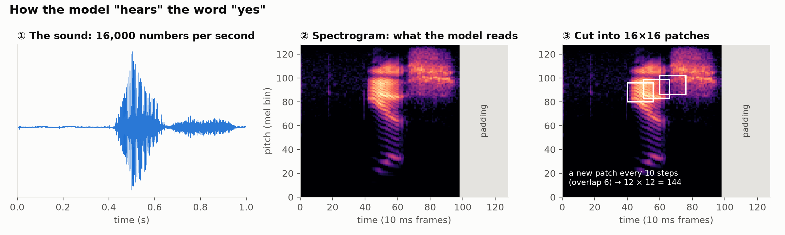
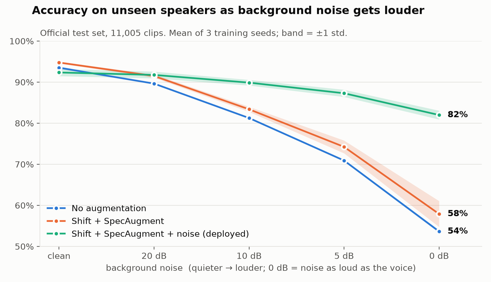
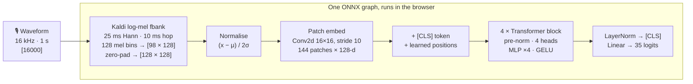

<div align="center">

# 🎙️ TinyAudioTransformer

**A tiny transformer that recognises spoken words, built from scratch in PyTorch and running in your browser.**

[](https://dhaaivat.github.io/TinyAudioTransformer/)

[](https://github.com/dhaaivat/TinyAudioTransformer/actions/workflows/tests.yml)


[](LICENSE)

</div>

Say **"yes"**, **"stop"**, **"marvin"** or any of 35 words. The model listens to one second of audio and tells you which word it heard, with how sure it is. It has **0.85 million parameters**, about 100× smaller than the research model it's based on. It was trained from scratch on 85,000 recordings, and it runs **entirely on your device**: your voice never leaves the browser.

<p align="center">
  <picture>
    <source media="(prefers-color-scheme: dark)" srcset="docs/assets/how_it_hears_dark.png">
    
  </picture>
</p>

---

## Contents

- [Try it](#-try-it)
- [Results at a glance](#-results-at-a-glance)
- [How it works, in plain words](#-how-it-works-in-plain-words)
- [How it works, technically](#%EF%B8%8F-how-it-works-technically)
- [How we know it's right](#-how-we-know-its-right)
- [What the experiments taught us](#-what-the-experiments-taught-us)
- [Limitations](#%EF%B8%8F-limitations)
- [Run it yourself](#-run-it-yourself)
- [Project map](#%EF%B8%8F-project-map)
- [Further reading](#-further-reading)

---

## 🎧 Try it

**→ [dhaaivat.github.io/TinyAudioTransformer](https://dhaaivat.github.io/TinyAudioTransformer/)**

1. Press **🎙 Record** and say one word (you have 2 seconds).
2. You'll see the model's top 5 guesses, the spectrogram it actually looked at, and a button to replay the exact second it heard.
3. Open the **Test it** tab to go through all 35 words. Your score is calculated in the browser, and you can download the results to help measure how the model does on real microphones.

**The 35 words:** backward · bed · bird · cat · dog · down · eight · five · follow · forward · four · go · happy · house · learn · left · marvin · nine · no · off · on · one · right · seven · sheila · six · stop · three · tree · two · up · visual · wow · yes · zero

> 🔒 **Privacy:** the model runs on your device using WebAssembly. No audio is uploaded or stored. The "Test it" mode keeps only which word was asked and what the model answered.

---

## 📊 Results at a glance

Tested on the official **Speech Commands v2** test set: 11,005 recordings from **250 people the model never heard during training**.

| | Accuracy |
|---|---|
| Clean audio | **93.4%** |
| With background noise at 5 dB SNR (noticeably noisy) | **88.1%** |
| With noise as loud as the voice (0 dB) | **83.1%** |
| Live test on a laptop microphone (35 words, 1 speaker) | 34 / 35 |
| How honest its confidence is (expected calibration error) | 0.8%: when it says 90% sure, it's right about 90% of the time |

<picture>
  <source media="(prefers-color-scheme: dark)" srcset="docs/assets/noise_robustness_dark.png">
  
</picture>

**The key result of the training experiments.** Models trained without background noise do slightly better on clean audio, but collapse when the room gets loud. The deployed model was trained with real background noise. It gives up about 2 points on perfectly clean audio and keeps **82%** where the others drop to 54–58%.

For context: a small CNN baseline on the same features scores 92.4%, and the 87M-parameter, ImageNet-pretrained [AST](https://arxiv.org/abs/2104.01778) reports 98.1%.

---

## 🧠 How it works, in plain words

1. **Sound is a list of numbers.** A microphone measures air pressure 16,000 times a second, so one second of speech is 16,000 numbers.
2. **Turn it into a picture.** Those numbers are converted into a *spectrogram*, a picture of which pitches are loud at each moment (time left to right, pitch bottom to top). Every word has its own shape: the "y" glide, the "e" vowel bands and the hissy "s" of *yes* are all visible above.
3. **Cut the picture into tiles.** The spectrogram is cut into 144 small overlapping squares, like a mosaic.
4. **Let the tiles talk to each other.** A *transformer*, the same kind of neural network behind modern language models, lets every tile look at every other tile. Over 4 layers it works out which tiles matter together: "a rising glide, then a vowel, then a hiss".
5. **Vote.** The model outputs a score for each of the 35 words, turned into percentages. The highest one is its answer.

It learned all of this from examples alone: 85,000 labelled recordings, shown about 30 times each. Along the way, the recordings were deliberately made harder: shifted in time, partly blanked out, and mixed with real background noise (a running tap, dishes, an exercise bike). That way the model learns the *word*, not the recording conditions.

---

## ⚙️ How it works, technically



| Component | Choice | Why |
|---|---|---|
| Features | Kaldi-compatible log-mel filterbank, written in plain PyTorch ([`features.py`](features.py)) | Same features as AST, so the code can be checked against the authors' released model. Owning it means it runs batched on the GPU and can be exported. |
| Architecture | AST-style ViT: overlapping 16×16 patches (stride 10), [CLS] pooling, pre-norm blocks | Follows [AST](https://arxiv.org/abs/2104.01778) at 1/100th of the size: 128-d, 4 layers, 4 heads |
| Training | AdamW (lr 1e-3, wd 0.05), warmup + cosine, 30 epochs, batch 256, mixed precision, 2×T4 on Kaggle | Standard ViT recipe. Weight decay is skipped on norms, biases and embeddings. |
| Augmentation | Time shift ±100 ms · SpecAugment (24 bins / 24 frames) · real background noise at 0–20 dB SNR | Chosen by a 45-run ablation (see [below](#-what-the-experiments-taught-us)). Waveform-level augmentation happens *before* feature extraction, where mixing sounds is physically additive. |
| Model selection | Best checkpoint and seed chosen on **validation**, test evaluated once | So the test number isn't quietly tuned |
| Deployment | One ONNX graph, **waveform in → logits out**, run by onnxruntime-web (WebAssembly) | Feature extraction lives inside the model, so the browser can't compute features differently from training. The FFT is exported as a matrix multiply with precomputed cos/sin tables. |

---

## ✅ How we know it's right

A model can look accurate and still be wrong in quiet ways: a leaky data split, a subtly different feature pipeline, a lucky random seed. Each layer of this project has a check that would fail if that layer were wrong:

| What could go wrong | The check | Result |
|---|---|---|
| Test speakers also appear in training | Official speaker-disjoint split, asserted in tests | 2,112 / 256 / 250 speakers with zero overlap |
| The architecture doesn't match the paper | **Parity test:** load the AST authors' released weights into this code and compare outputs with Hugging Face's AST | Logits match to within 1e-3 |
| The features don't match | Compared with `torchaudio`'s Kaldi fbank and Hugging Face's AST feature extractor | Match |
| Training is broken but the loss still goes down | Overfit-one-batch test: the model must memorise 128 clips | Passes |
| An "improvement" is just a lucky seed | Every config trained with 3 seeds, compared **paired by seed**, McNemar test per seed | Only gains positive on all seeds were kept |
| The model is right but overconfident | Expected calibration error, and confidence − accuracy (with sign) | ECE 0.8%, confidence ≈ accuracy |
| It only works on clean audio | Re-scored with **held-out** background noise at 20/10/5/0 dB | 83% at 0 dB |
| The browser computes something different | ONNX Runtime compared with the PyTorch *training* pipeline on 8,000 real clips | Max logit difference 3·10⁻⁵, 100% identical predictions |
| It doesn't work on a real microphone | "Test it" mode in the live demo | 34/35 on the first run (n is small: 95% CI 85–100%) |

These run as **45 automated tests** ([`tests/`](tests/)) on every push.

---

## 🔬 What the experiments taught us

Training used **45 runs** over two rounds (each configuration × 3 seeds) to find out which tricks actually help a tiny model. Full analysis is in the [learning log](docs/LEARNING_LOG.md).

| Augmentation | Effect on clean accuracy | Verdict |
|---|---|---|
| Time shift (±100 ms) | **+1.0**, all seeds | ✅ keep |
| SpecAugment | **+1.1**, all seeds, and better calibration | ✅ keep |
| Shift + SpecAugment together | +1.25 (they overlap, so they don't fully add up) | ✅ keep |
| Mixup | +0.4 alone, but **−1.4** on top of shift + SpecAugment | ❌ drop |
| Label smoothing | no gain, and the model becomes *under*confident | ❌ drop |
| Background noise | −2.4 on clean audio, but **+24 at 0 dB** | ✅ keep: real rooms aren't silent |
| All five at once | **−4.9**, unstable across seeds | ❌ too much regularisation for 0.85M parameters |

Three lessons that generalise:

- **Tricks interact.** Mixup helped alone and hurt in combination. Test combinations, not just single changes.
- **Your test set defines "better".** On clean audio, noise training looked harmful. On noisy audio, it was by far the most valuable change.
- **Calibration error has a direction.** Label smoothing "fixed" overconfidence by overshooting into underconfidence. ECE alone hid that.

---

## ⚠️ Limitations

- **It always picks one of the 35 words.** There's no "unknown" or "silence" class, so any sound gets mapped to its closest word. The demo uses a loudness gate and flags low-confidence answers, but that's a workaround.
- **Confusable pairs** are the main error source: tree ↔ three, go ↔ no, four ↔ forward.
- **Accents and voices:** the dataset doesn't record speaker demographics, so performance across accents, ages and voice types is unmeasured, and likely lower for under-represented groups.
- **Noise:** "held-out" noise means unseen segments of the same 6 recordings. Other people talking, music and echoey rooms weren't tested.
- **Not for anything that matters:** it's a learning project, not a safety, accessibility or authentication tool.

Details are in the [model card](docs/MODEL_CARD.md).

---

## 🚀 Run it yourself

**Run the demo locally**

```bash
git clone https://github.com/dhaaivat/TinyAudioTransformer.git
cd TinyAudioTransformer/web
python3 -m http.server 8000      # then open http://localhost:8000
```

**Run the tests**

```bash
pip install -r requirements.txt
python -m pytest tests -q
# data tests need the dataset: SC_ROOT=/path/to/speech_commands_v2 python -m pytest tests -q
```

**Train**

The full pipeline is packaged as self-contained Kaggle notebooks (GPU T4 ×2, about 1–1.5 hours each), generated from the repo sources by [`kaggle/build_notebook.py`](kaggle/build_notebook.py):

| Notebook | What it does |
|---|---|
| [`tiny_audio_transformer_phase01.ipynb`](kaggle/tiny_audio_transformer_phase01.ipynb) | Data split checks, parity tests, first baselines |
| [`tiny_audio_transformer_phase2.ipynb`](kaggle/tiny_audio_transformer_phase2.ipynb) | Augmentation ablation, 27 runs |
| [`tiny_audio_transformer_phase2b.ipynb`](kaggle/tiny_audio_transformer_phase2b.ipynb) | Combinations + noisy evaluation, 18 runs: produces the deployed model |

Or locally, with a GPU:

```bash
python prepare_data.py --root data/speech_commands_v2 --cache-dir data/cache     # download + cache (≈ 2.7 GB)
python train.py --model tat --aug shift,specaug,noise --cache-dir data/cache --out-dir runs/mine
python eval_noisy.py runs --cache-dir data/cache                                  # robustness to noise
python export_onnx.py runs/mine/best.pt web/model                                 # → browser model, parity-checked
```

---

## 🗺️ Project map

```
├── features.py          Kaldi log-mel filterbank in plain PyTorch
├── patch_embed.py       spectrogram → overlapping 16×16 patches
├── transformer_block.py pre-norm transformer encoder block
├── model.py             TinyAudioTransformer (+ in-model feature normalisation)
├── baselines.py         small CNN baseline for comparison
├── ast_reference.py     loads the AST authors' weights into this code (parity testing)
├── dataset.py           Speech Commands v2: official split, waveform cache, noise banks
├── augment.py           time shift, mixup, background noise, SpecAugment, label smoothing
├── train.py             training loop: AMP, warmup + cosine, val selection, single test pass
├── metrics.py           accuracy, calibration error, confusion matrix, McNemar test
├── sweep.py             runs experiment grids × seeds across GPUs (resumable)
├── analyze.py           paired-by-seed comparison tables
├── eval_noisy.py        re-scores checkpoints with held-out noise at fixed SNRs
├── export_onnx.py       waveform → logits ONNX graph, checked against the training pipeline
├── tests/               45 tests: features, model, splits, AST parity, augmentation, export
├── kaggle/              notebook generator + the generated notebooks
├── web/                 the live demo (HTML/CSS/JS + model/tat.onnx)
└── docs/
    ├── LEARNING_LOG.md        every step, why it was taken, what it taught (+ glossary)
    ├── MODEL_CARD.md          intended use, metrics, limitations
    └── reference_comparison.md   this code vs. the AST reference, line by line
```

---

## 📚 Further reading

- **[Learning log](docs/LEARNING_LOG.md):** the full story, session by session: bugs found, decisions made, results, and a glossary of every audio and ML concept used. A good starting point if you want to learn from this project.
- **[Model card](docs/MODEL_CARD.md):** what the model is for, how it was evaluated, and where it fails.
- **[Reference comparison](docs/reference_comparison.md):** every place this implementation matches or deliberately differs from AST.

### Built on

- **Data:** P. Warden, [*Speech Commands: A Dataset for Limited-Vocabulary Speech Recognition*](https://arxiv.org/abs/1804.03209), 2018 (CC BY 4.0)
- **Architecture:** Y. Gong, Y.-A. Chung, J. Glass, [*AST: Audio Spectrogram Transformer*](https://arxiv.org/abs/2104.01778), Interspeech 2021
- **Related:** A. Berg, M. O'Connor, M. T. Cruz, [*Keyword Transformer*](https://arxiv.org/abs/2104.00769), Interspeech 2021
- **Augmentation:** D. S. Park et al., [*SpecAugment*](https://arxiv.org/abs/1904.08779), Interspeech 2019
- **Runtime:** [ONNX Runtime Web](https://onnxruntime.ai/docs/tutorials/web/)

---

<div align="center">

Made by **Dhaaivat Patil** · [MIT License](LICENSE)

</div>
